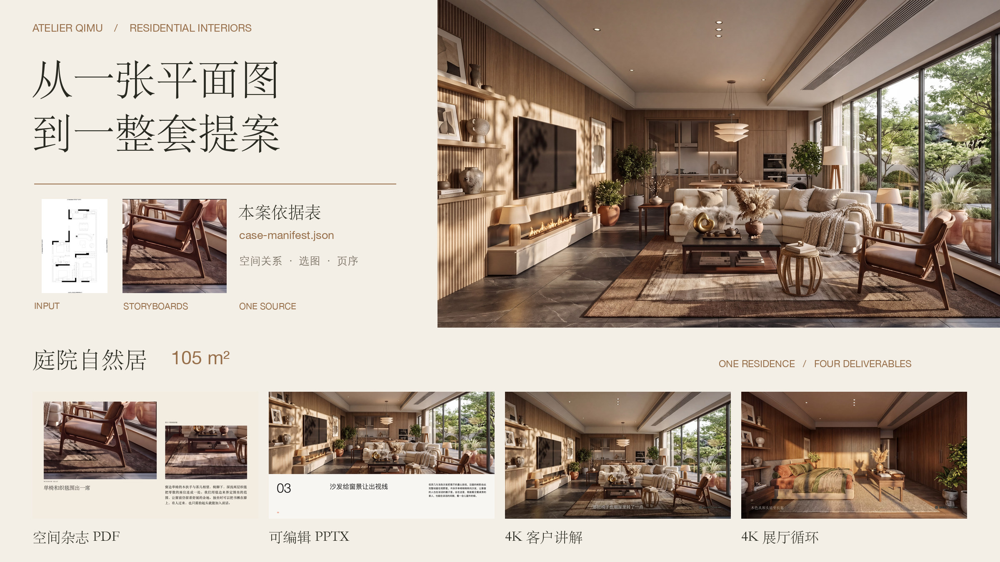
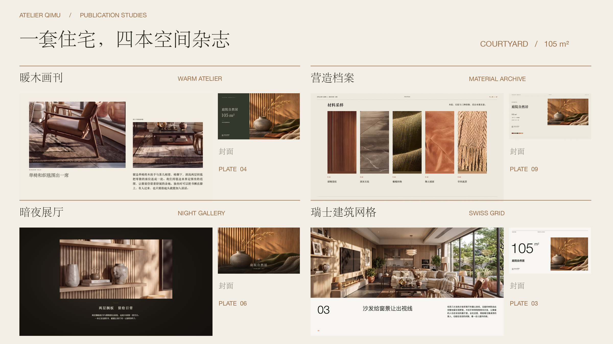
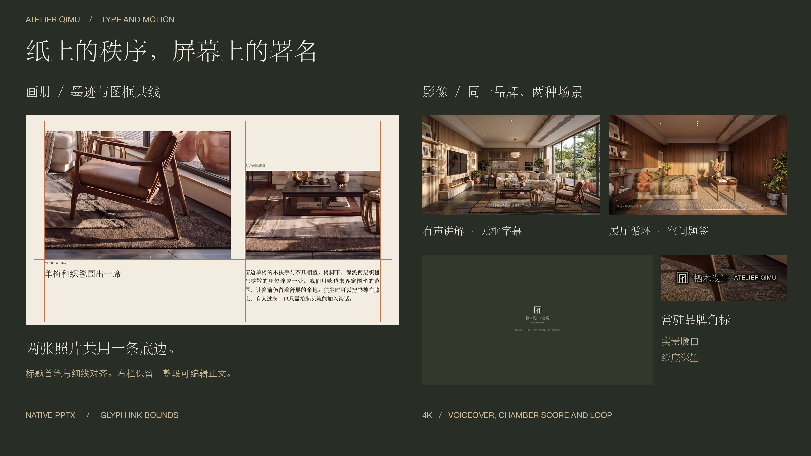

# plan-to-studio-showcase

## 图画完了，客户还没看见怎么住

发到业主微信群，十张图，客户划十秒。业务员拿走一页平面，讲着讲着就跳到下一张效果图。展厅电视循环播着人声广告，旁边的同事只好提高嗓门谈单。

同一个家，三个场合，需要三种看法。

**plan-to-studio-showcase** 从一张平面图和一组同案效果图出发。设计师核对一次空间事实，工作流据此做出一套事务所级提案。客户可以听人讲，设计师可以当面翻，展厅也可以安静地播。

> 先看一家人怎么围着餐桌坐下，再看光怎样从窗边走进客厅。


[▶ 观看有声精剪实片（720p MP4 · 含中文配音与室内乐混音）](assets/readme/media/showcase-highlight-720p.mp4)

<!-- Phase B: place the approved GitHub attachment players below the MP4 link. -->



样案为脱敏的「庭院自然居」，面积 105 m²，使用示例品牌「栖木设计事务所」。上面是成片剪辑和实际导出的画册页。

| 谁在看 | 交付什么 |
| --- | --- |
| 客户在微信里看 | 带中文口播、同期字幕和室内乐的 4K 讲解片 |
| 设计师在桌边讲 | 四款可编辑 PPTX 与同版 PDF，可翻页、换图、修字 |
| 来访者在展厅里走 | 4K 无口播氛围循环片，保留现场交谈的空间 |

---

## 一套方案，走过三道工序

`plan-to-cad` → `cad-plan-to-room-render` → `plan-to-studio-showcase`

第一步，把户型图整理为可编辑、可核尺寸的 CAD。第二步，沿着确认的墙体、门窗和家具关系做彩平与室内效果图。第三步，把图面已确认的内容写成能读、能讲、能在展厅播的方案。

手头已有核对过的彩平和同案分镜，可以从第三步开始。画册、口播、字幕和镜头引用同一份依据表。哪张图能说明房间关系，哪张图只能说明可见纹理，可以逐条查回去。遇到效果图与彩平冲突，先请设计方确认。

[本案依据表示例](examples/courtyard-105-sample/case-manifest.example.json) · [文案与口播写法](references/copywriting-standard.md)

---

## 四处细节，决定提案看起来像什么

### 01 · 文字跟着视觉边缘走

暖木画刊、瑞士建筑网格、暗夜展厅和营造档案，是四套不同的阅读节奏。双图页先定共用底边，再从图片边缘拉出文字轴。FreeType 测出首字的可见墨迹边界，用 Ink-Box 左偏移补偿字形自己的留白。列标题和正文看起来才真正对齐。

文字、徽标和色卡保留为可编辑的 PPTX 对象。PDF 由同一版式输出，供印刷和分享。样案四套画册的 HTML 源稿均通过 `measure-cjk`，实测 0 错误、0 警告。



[画册模板与导出](references/brochure-templates.md)

### 02 · 客户跟得上，展厅安静地播

讲解片里，彩平停住。同期字幕移到右栏，和「平面」标题共用一条视觉左轴。客户可以一边听六个座位怎么排，一边看清墙和门。到客厅，画面缓缓向里推进。

展厅版保留室内乐，去掉口播。首尾解码帧逐像素对比，差异为 0。原图像素不足时，可用本机免费 Real-ESRGAN 补足展示尺寸。

### 03 · 声音留出说话的地方

快速出稿可以用免费微软 `edge-tts`，选云扬或晓晓。需要另一种声音表现时，可选海螺 `speech-2.8-hd`。有人说话，室内乐自动收低。开场和换镜的气口，音乐仍在。讲解片母带目标为 −16 LUFS，展厅版为 −18 LUFS。



### 04 · 署名贯穿影片，返修能回到原处

在 `brand.json` 写好品牌名、明暗徽标、颜色和尾句。开场落完整署名，中间镜头按底色切换角标。最后一句品牌口播起声时，画面同步进入品牌落版。

改一页可以用 `--only-page`。只换画面可以用 `update_video_picture.py` 复用现有编码音轨。回来再看时，改了哪句话、引用哪张图、用了哪条音轨，都有对应文件可查。

[品牌配置示例](assets/brands/atelier-qimu/brand.json) · [配音与母带手册](references/video-and-audio.md)

---

## 第一次做，从三步开始

1. 准备一张平面线稿或彩平、一组同案效果图。带上已确认的案名与品牌配置。
2. 在能读取仓库和素材的 Agent 中，贴上下面这段话。
3. 先核对选图、彩平和一页试排，再让 Agent 生成全套成果。完成后打开案例目录的「审阅总览.html」，在同一页翻画册、看片和查素材。

> 使用 plan-to-studio-showcase，把这张彩平和同案效果图做成住宅提案。先让我确认采用哪些图、哪些地方还需核对。画册选暖木画刊，讲解片用微软云扬，再做一支无口播展厅片。请一起交付可编辑 PPTX 和音频缓存。

### 命令行复现

在仓库根目录执行。画册使用 macOS 系统字体、Chrome 和 `measure-cjk`。视频使用 FFmpeg 和 FFprobe。在需要超分时，脚本调用本机的 Real-ESRGAN。仓库附脱敏配置与预览，原始分镜由使用者提供。[Agent 执行说明](SKILL.md)

```sh
python3 -m venv .venv
. .venv/bin/activate
python -m pip install -r requirements.txt
python scripts/doctor.py

case_dir=local/my-case
brand=assets/brands/atelier-qimu/brand.json
mkdir -p "$case_dir/raw"
# 将素材副本放入 raw，完整彩平命名为 color-plan.png。
python scripts/ingest_assets.py "$case_dir" --min-width 3600
```

结合体检报告和审图结果填写 `case-manifest.json` 与 `script.json`。用同一组素材 ID 串起十页画册和十个镜头。两份文件都放进案例目录。房间索引、路线、章节名和材质取样可在依据表中指定。需要精修满幅页时，可以在该页脚本中提供两行导读。[依据表样例](examples/courtyard-105-sample/case-manifest.example.json) · [脚本样例](examples/courtyard-105-sample/script.example.json)

```sh
python scripts/build_brochure.py --manifest "$case_dir/case-manifest.json" \
  --script "$case_dir/script.json" --brand "$brand" --assets-dir "$case_dir" \
  --out-dir "$case_dir/brochures" --template all
python scripts/verify_brochure.py --out-dir "$case_dir/brochures" \
  --script "$case_dir/script.json" --brand "$brand"

python scripts/synthesize_voice.py --case "$case_dir" --provider edge --brand "$brand"
python scripts/render_video.py --case "$case_dir" --mode edge --brand "$brand"
python scripts/render_video.py --case "$case_dir" --mode tv --brand "$brand"
python scripts/verify_video.py --case "$case_dir" --brand "$brand"
python scripts/build_review.py --case "$case_dir"
```

### 海螺密钥

海螺按账户计费。确认费用和使用范围后，从 MiniMax 开放平台获取密钥。用 zsh 隐藏输入，使用完即从会话中清除。配置、日志和 Git 历史里都应省略密钥。相同请求会复用缓存。

```zsh
read -rs 'MINIMAX_API_KEY?海螺密钥：'
export MINIMAX_API_KEY
python scripts/synthesize_voice.py --case "$case_dir" --provider hailuo --brand "$brand"
unset MINIMAX_API_KEY
python scripts/render_video.py --case "$case_dir" --mode hailuo --brand "$brand"
```

---

## 开源使用，也欢迎一起做一套

仓库按 MIT 协议完整开源。欢迎同行设计师、独立工作室和开发者取用、修改，也欢迎把自己的品牌和排版想法做成新模板。[MIT 许可证](LICENSE) · [素材与配乐署名](THIRD_PARTY_NOTICES.md)

工具能完成导出，稳定做到出版级还有一半功夫在图面上。设计师要审读和剔重，核对平面与效果图的矛盾，再把物件、空间关系和生活场景写成三层导读。字形边缘和专属品牌母版，也值得在最后一轮慢慢校准。

如果你经营独立设计工作室、装修企业或家居品牌，希望按户型直接交付可编辑 PPTX、PDF 画册、4K 讲解片和展厅循环片，或想按自己的品牌 VI 定制版式、配音和声画标准，欢迎在仓库 Issues 留言，或通过 GitHub 主页联系。[@yangplato](https://github.com/yangplato)
